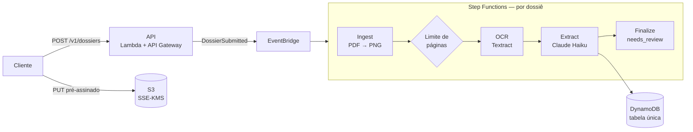

# Parsen

**Documentos em dados.** Plataforma de IA que lê documentos brasileiros (holerite, extrato, comprovante de residência, matrícula) e devolve os dados estruturados, com evidência por campo e verificações determinísticas.

Nichos iniciais:

- **Fintechs:** comprovação de renda via API.
- **Imobiliário:** análise de dossiê no backoffice.

> **A Parsen verifica fatos; a política é do cliente.** A plataforma devolve dados, verificações (`checks`), fatos (`facts`) e sinais (`signals`), mas nunca aprova nem reprova. A decisão é sempre de quem integra.

## Status

| Fase | Situação |
| --- | --- |
| 0. Setup da conta AWS | Concluída |
| 1. Fundação | **Concluída (21/10/2026):** holerite ponta a ponta na AWS |
| 2. Documentos | A iniciar: split, classificação, extrato, comprovante de residência, matrícula |
| 3. Verificações | Verificações, fatos, sinais, renda expressa |
| 4. Backoffice | Fila, revisão com destaque no PDF, correção, auditoria |
| 5. Piloto | Primeiro cliente |

O roadmap completo e as decisões estão na [seção 14 da spec](docs/spec.md#14-roadmap-e-decisões).

## Como funciona

Tudo é serverless e assíncrono, em `sa-east-1`:

1. O cliente cria um dossiê na API.
2. Ele recebe uma URL pré-assinada e envia os arquivos direto ao S3.
3. No `submit`, a API publica `DossierSubmitted` no EventBridge.
4. O evento inicia uma execução do Step Functions por dossiê.



| Etapa | O que faz |
| --- | --- |
| **Ingest** | Renderiza cada página em PNG (PDFium) e recusa PDF com senha ou acima do limite |
| **Limite de páginas** | Soma as páginas do dossiê. Acima de 50, o dossiê falha antes de gastar com OCR e modelo |
| **OCR** | Textract `DetectDocumentText`. Ele não existe em `sa-east-1`, então os bytes da página vão para `us-east-1` e o resultado é gravado de volta no Brasil |
| **Extract** | Claude via Bedrock Converse, com o JSON Schema versionado como ferramenta obrigatória. O modelo devolve valor, página e trecho, e o código C# casa o trecho com o OCR para obter a bounding box e a confiança |
| **Finalize** | Grava o status final do dossiê (`needs_review` ou `failed`) |

### Princípios

- **O modelo extrai e sinaliza; regras em C# verificam.** As verificações são determinísticas e testáveis (`Parsen.Domain`, sem dependência de AWS).
- **Confiança vem do OCR, não do modelo.** Um campo cujo trecho não aparece no documento recebe confiança 0 e vai para revisão.
- **Multi-tenant por construção:** o `tenantId` vem sempre do token (Cognito). Toda chave no DynamoDB começa com `TENANT#` e todo objeto no S3 fica sob o prefixo do tenant.
- **LGPD:** não há dados pessoais em logs, URLs ou no histórico do Step Functions, que só recebe IDs e contagens. Os documentos têm retenção configurável por tag no S3.
- **Custo por documento é prioridade.** Na Fase 1, um holerite de 1 página custou ~US$ 0,011 (Textract + Haiku 4.5).

## Stack

| Camada | Tecnologia |
| --- | --- |
| Linguagem | .NET 10 (C#) |
| API | ASP.NET Core Minimal API em Lambda, API Gateway REST, Cognito (client credentials) |
| Pipeline | Lambdas .NET **Native AOT** (uma por etapa), Step Functions Standard, EventBridge |
| IA | Amazon Bedrock (Claude Haiku), Amazon Textract |
| Dados | DynamoDB (tabela única), S3 com KMS |
| Infraestrutura | AWS CDK em C# |
| Testes | xUnit, Testcontainers (DynamoDB Local) |

## Estrutura do repositório

```
src/
  Parsen.Api/                     # API pública (Minimal API)
  Parsen.Domain/                  # Entidades e regras, sem dependência de AWS
  Parsen.Application/             # Casos de uso e portas (interfaces)
  Parsen.Infrastructure/          # Adaptadores: DynamoDB, S3, Bedrock, Textract, EventBridge
  Parsen.Schemas/                 # JSON Schemas e prompts versionados (ex.: holerite.v2)
  Parsen.Auth.PreTokenGeneration/ # Gatilho do Cognito que injeta o tenant_id no token
  Parsen.Workers/                 # Uma Lambda AOT por etapa: Ingest, Ocr, Extract, Finalize
infra/Parsen.Cdk/                 # Stacks CDK: Data, Auth, Pipeline, Api
tests/                            # Testes por projeto (integração com DynamoDB Local via Docker)
spikes/                           # Provas de conceito (ex.: PDFium em Native AOT)
docs/spec.md                      # Especificação técnica do MVP
```

## Como rodar

### Pré-requisitos

- [.NET SDK 10](https://dotnet.microsoft.com/download) (versão fixada em `global.json`)
- [Docker](https://www.docker.com/) para os testes de integração e o build das Lambdas AOT
- [Node.js](https://nodejs.org/) e o AWS CDK CLI (`npm install -g aws-cdk`), só para deploy
- [AWS CLI v2](https://aws.amazon.com/cli/), só para deploy

### Build e testes

```bash
dotnet build      # build da solução (avisos são tratados como erro)
dotnet test       # todos os testes; os de integração exigem Docker rodando
```

Nenhum teste automatizado chama o Bedrock: respostas do modelo vêm de fixtures sintéticas.

### Deploy

As Lambdas Native AOT são compiladas num container Amazon Linux 2023 durante o bundling do CDK, para usar a mesma glibc do runtime da Lambda.

```bash
cd infra/Parsen.Cdk
cdk diff --profile <perfil>       # sempre revisar antes
cdk deploy --all --profile <perfil>
```

Regiões, IDs de modelo do Bedrock e a região do Textract são parâmetros (`infra/Parsen.Cdk/StageSettings.cs`), nunca fixos no código.

## Regras do projeto

As regras de desenvolvimento estão no [`CLAUDE.md`](CLAUDE.md). As principais:

- Sem documentos reais no repositório: as fixtures são sintéticas.
- Sem segredos no código nem em variáveis de ambiente em texto puro.
- Infraestrutura só via CDK.
- Toda mudança em prompt ou schema gera uma nova versão (`holerite.v3`…) e passa pelo `Parsen.Eval` antes do merge.
- Valores monetários sempre em `decimal`, nunca `double`.

## Documentação

- [Especificação técnica do MVP](docs/spec.md): produto, arquitetura, API, modelo de dados, verificações, LGPD, custos e roadmap.
- [CLAUDE.md](CLAUDE.md): convenções e regras para quem desenvolve (pessoas e o Claude Code).
