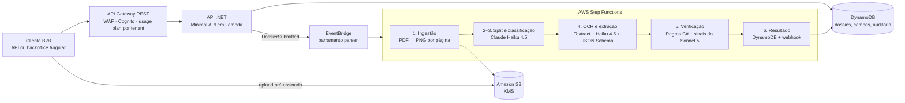

# Parsen — Especificação Técnica do MVP

> Fonte: documento "Parsen — Especificação Técnica do MVP" (versão de 12/10/2026, revisada em 13/10/2026). Este arquivo é a cópia de referência para o repositório; ao alterar decisões, atualize os dois.

## 0. Setup do ambiente

O desenvolvimento começa numa conta AWS pessoal no Free Plan, usando os créditos para criar e validar o MVP antes de qualquer upgrade. O acesso é por usuário IAM com MFA, porque o IAM Identity Center exige AWS Organizations, que exige o Paid Plan. Quando o CNPJ existir, essa mesma conta faz upgrade, passa a faturar contra a empresa, vira a conta de gestão da organização e o produto vai para contas-membro de dev e produção, via CDK.

> Atenção: AWS Builder ID é só um perfil de desenvolvedor, não uma conta AWS; nele não há MFA de root, IAM nem Identity Center.

**Criação da conta**

- [x] Criar a conta AWS (o root usa o e-mail pessoal; trocar para um endereço do domínio, ver abaixo)
- [x] Escolher o Free Plan, com US$ 200 em créditos; o upgrade fica para quando o CNPJ existir
- [x] Confirmar em Billing → Credits se os créditos cobrem os modelos Claude: **não cobrem** (cobrança via AWS Marketplace). Todo uso do Claude no desenvolvimento é gasto real no cartão; os créditos cobrem o restante (Lambda, S3, Textract, Step Functions etc.)

**Primeiro dia**

- [x] Ativar MFA no usuário root e não usá-lo no dia a dia
- [x] Criar usuário IAM de trabalho (`parsen-development`) com acesso ao console, MFA e `AdministratorAccess` (restringir quando o CDK tiver role própria); sem access keys
- [x] Configurar a CLI com `aws login --profile parsen` (AWS CLI v2 recente; credenciais temporárias via console, nada de chaves fixas). Plano B: access key que só pode assumir uma role de administrador com MFA
- [x] Configurar AWS Budgets com alertas em US$ 50, 100 e 150 (budget `parsen-mensal`, consumo bruto sem descontar créditos, mais alerta de previsão em US$ 150)
- [x] Definir sa-east-1 como região padrão do perfil `parsen` da CLI (Textract em us-east-1)
- [x] Enviar o formulário de caso de uso da Anthropic no console do Bedrock (uma vez por conta)
- [x] Conferir os modelos Claude em sa-east-1. A página "Model access" foi aposentada; os modelos serverless são habilitados no primeiro uso. Inference profiles Global ativos:
  - Haiku 4.5: `global.anthropic.claude-haiku-4-5-20251001-v1:0`
  - Sonnet 5: `global.anthropic.claude-sonnet-5`
- [x] Criar o repositório `parsen-idp/parsen` no GitHub

**Acesso pela CLI:** sempre com `--profile parsen`; quando as credenciais expirarem, rodar `aws login --profile parsen` de novo. O perfil `default` da máquina de desenvolvimento aponta para outra conta e não deve ser usado no projeto.

O CI/CD usa GitHub Actions com OIDC (role IAM com trust no repositório), sem chaves fixas.

**Quando o domínio for registrado**

- [ ] Trocar o e-mail do usuário root para um endereço do domínio da Parsen
- [ ] Verificar o domínio no SES e pedir a saída do sandbox

**Quando o CNPJ for aberto**

- [ ] Atualizar dados de faturamento e fiscais para a AWS Brasil faturar contra o CNPJ
- [ ] Fazer upgrade para o Paid Plan, ativar AWS Organizations e IAM Identity Center (esta conta vira a gestão); migrar o acesso do usuário IAM para o Identity Center
- [ ] Criar, dentro da organização, as contas-membro `parsen-dev` e `parsen-prod`; a conta de gestão fica só com faturamento e acesso
- [ ] Implantar dev e produção nas contas-membro (mesmo código CDK, conta e região por parâmetro)

**LGPD durante o desenvolvimento:** na conta pessoal, usar só documentos sintéticos ou próprios. Documentos reais do piloto entram apenas no ambiente coberto por contrato e DPA, já na conta da empresa.

## 1. Visão geral

A Parsen transforma dossiês de documentos brasileiros em dados validados e prontos para decisão, começando por análise de renda (fintechs) e análise documental de locação e compra (imobiliário).

| Item | Definição |
| --- | --- |
| Marca | Parsen |
| Slogan | Documentos em dados. |
| Descrição comercial | Plataforma de inteligência artificial para extração e estruturação de dados de documentos. |
| Referência | [Affinda Extract](https://www.affinda.com/extract/) (mesmo modelo de produto, versão vertical e brasileira) |
| Público inicial | Fintechs de crédito e onboarding; imobiliárias, administradoras e correspondentes de financiamento |
| Modelo operacional | Sem time de operação: a revisão humana é feita pelo time do próprio cliente |

**Problema:** a mesa de crédito e o backoffice imobiliário conferem documentos manualmente — leem holerite, extrato e matrícula, recalculam renda e cruzam nomes entre documentos.

**Proposta de valor:** a Parsen faz a leitura, a extração, o cálculo e as verificações; o analista do cliente só trata o que foi apontado. Meta comercial: o mesmo analista processa de 3 a 5 vezes mais dossiês.

**Princípio: a Parsen verifica fatos; a política é do cliente.** A Parsen extrai dados, executa verificações objetivas (dígito de CPF, soma do holerite, CPF igual entre documentos) e devolve fatos e sinais com evidência. Ela não aprova nem reprova: decidir se um holerite de 60 dias é aceitável ou qual renda basta é política de crédito do cliente. No MVP o cliente aplica a política no próprio sistema (API) ou pelo analista (backoffice); a partir da fase 2 a política poderá ser configurada no backoffice (seção 15).

**Diferencial frente ao Affinda:** templates prontos para documentos brasileiros, verificações nativas (CPF/CNPJ, renda líquida, ônus de matrícula, validade de certidões), saída por decisão do nicho, LGPD, contrato e preço em reais.

**Valor por segmento:** na fintech, o gargalo para aprovar a proposta é comprovar renda rápido; a Parsen integrada ao fluxo do parceiro devolve renda estruturada em segundos e aumenta a conversão de propostas. No imobiliário, o valor é a análise completa do dossiê de inquilino ou imóvel.

**Open Finance (ponto de atenção):** parte das fintechs comprova renda por Open Finance. A Parsen complementa onde ele não resolve: o fluxo de consentimento tem atrito e muitos usuários abandonam, autônomos e renda por holerite, IRPF ou pró-labore, e cruzamento de documentos para antifraude. Validar no piloto em que percentual das propostas o Open Finance não resolve.

## 2. Escopo do MVP

O MVP entrega um caso de uso ponta a ponta — análise de renda para locação e crédito — com 4 tipos de documento, API e backoffice.

**Documentos da fase 1**

| Documento | Nicho | Campos-chave |
| --- | --- | --- |
| Holerite | Fintech e imobiliário | Nome, CPF, empregador, CNPJ, competência, salário bruto, descontos, líquido |
| Extrato bancário | Fintech e imobiliário | Titular, banco, período, créditos recorrentes, saldo médio |
| Comprovante de residência | Fintech e imobiliário | Titular, endereço, CEP, data de emissão |
| Matrícula do imóvel | Imobiliário | Número, cartório, proprietários, ônus e averbações |

**Fase 2 (após o piloto):** CNH/RG, IRPF (declaração e recibo), cartão CNPJ e contrato social, contrato de locação, IPTU, certidões negativas.

**Dentro do escopo**

- Upload via API e backoffice, inclusive PDF único com vários documentos (split)
- Classificação automática do tipo de documento
- Extração com evidência por campo (página e posição)
- Verificações objetivas e cruzamento entre documentos do dossiê (fatos, não política)
- Fila de revisão, correção e aprovação no backoffice (a aprovação é do analista do cliente)
- Webhooks de status e resultado; modo renda expressa para fintechs (até 6 arquivos e 20 páginas, resposta em segundos)
- Multi-tenant com isolamento de dados

**Fora do escopo** (ver seção 15)

- Configuração de política e de workflows pelo cliente (limites, aprovação automática, regras próprias)
- Decisão de aprovação ou reprovação pela Parsen
- Ingestão por e-mail, portais e storages externos
- Componente de revisão embutível (entra quando o primeiro cliente pedir)
- Deploy single-tenant ou na VPC do cliente
- Manuscritos

## 3. Modos de consumo

O backoffice da Parsen é só mais um cliente da API pública: tudo o que a tela faz, o cliente também faz via API.

| Modo | Perfil de cliente | Como funciona | No MVP |
| --- | --- | --- | --- |
| Backoffice completo | Imobiliária ou fintech pequena, sem TI | Upload, revisão e exportação na tela da Parsen | Sim |
| Headless (só API) | Fintech com time de produto | Envia via API, recebe JSON com evidências por webhook, aplica a própria política | Sim |
| API + revisão embutida | Fintech com sistema próprio | Componente de revisão da Parsen dentro do sistema do cliente (Angular Element) | Fase 2 |

Consequência de design: nenhum endpoint interno exclusivo do backoffice. Revisão, correção, aprovação e administração passam pela mesma API, para que auditoria e aprendizado por correção funcionem nos três modos.

## 4. Arquitetura AWS

Tudo serverless e assíncrono: o cliente envia o arquivo direto ao S3, a API publica um evento quando o dossiê é submetido e o Step Functions conduz o pipeline, evitando o limite de ~29 s do API Gateway.



A API cria dossiês, entrega URLs de upload e, no `submit`, confere os arquivos no S3, muda o status para `processing` e publica `DossierSubmitted` no EventBridge. Uma regra do barramento inicia uma execução do Step Functions por dossiê, que termina gravando no DynamoDB e notificando o cliente por webhook. A renda expressa é a exceção: processa de forma síncrona na própria Lambda da API (seção 7).

| Serviço | Papel |
| --- | --- |
| API Gateway (REST) + WAF | Entrada da API pública; usage plan por tenant para throttling e quota |
| Cognito | Usuários do backoffice (MFA) e client credentials da API; Pre Token Generation trigger injeta o `tenantId` no token |
| Lambda (.NET) | API e workers de cada etapa |
| S3 | Originais, páginas renderizadas e saída do Textract; SSE-KMS; tag de retenção por objeto |
| EventBridge | Barramento próprio; dispara o pipeline no evento `DossierSubmitted` |
| Step Functions (Standard) | Orquestração, retries, espera pela revisão humana |
| Textract | OCR e posições para evidência; chamado em us-east-1 (não existe em sa-east-1), com os bytes da página, sem gravar nada fora do Brasil |
| Bedrock | Claude Haiku 4.5 e Sonnet 5 |
| DynamoDB | Dossiês, campos, verificações, sinais, auditoria, uso, idempotência |
| SQS + Lambda | Entrega de webhooks com retry e DLQ |
| Amplify Hosting / CloudFront | Backoffice Angular |
| KMS, Secrets Manager | Chaves por tenant, segredos de webhook, chave do índice de titular |
| CloudWatch, X-Ray, Budgets | Logs, rastreamento e alertas de custo |

**Regiões:** desenvolvimento e produção em sa-east-1 (São Paulo); o desenvolvimento usa só documentos sintéticos. Textract em us-east-1 nos dois ambientes. A região principal, a região do Textract (`TextractRegion`) e os IDs de modelo/inference profile do Bedrock são parâmetros do CDK e da configuração, nunca fixos no código, para que a migração seja só um novo deploy.

## 5. Pipeline de processamento

Seis etapas na mesma linha do Affinda Extract; cada uma é uma Lambda idempotente, com retry e versão registrada no resultado.

| Etapa | Worker | Entrada | Saída | Serviço |
| --- | --- | --- | --- | --- |
| 1. Ingestão | Ingest | Arquivos no S3 + evento `DossierSubmitted` | Páginas renderizadas em PNG, contagem de páginas, débito de créditos | Lambda .NET (PDFium) |
| 2. Split | Split | PDF com vários documentos | Faixas de páginas por documento | Haiku 4.5 |
| 3. Classificação | Classify | Primeira página de cada faixa | Tipo do documento + confiança | Haiku 4.5 |
| 4. OCR e extração | Ocr, Extract | Páginas + texto do Textract | Campos com valor, confiança e evidência | Textract + Haiku 4.5 |
| 5. Verificação | Validate | Todos os campos do dossiê | Verificações, fatos, sinais e resultado consolidado | Regras C# + Sonnet 5 |
| 6. Integração | Notify | Resultado | Gravação no DynamoDB, webhook, status | Lambda + SQS |

**Ingestão e Native AOT:** a renderização de PDF usa PDFium (biblioteca `PDFtoImage`). O spike A (`spikes/PdfRenderAot`) confirmou que o worker Ingest roda em Native AOT no Amazon Linux 2023, em x64 e arm64, com ~165 ms por página a 150 DPI e pacote de ~21 MB; não há exceção ao AOT. O build de todas as Lambdas AOT roda em container Amazon Linux 2023 (mesma glibc do runtime), nunca direto no Windows. Arquitetura (x64 ou arm64/Graviton, ~20% mais barato) a decidir na configuração dos workers.

**Saída da verificação** (regra técnica de fila, não política de crédito)

- Nenhuma verificação com falha e nenhum sinal → status `ready` (pronto para o analista aprovar em um clique)
- Alguma verificação com falha ou algum sinal → status `needs_review`, dossiê entra na fila do backoffice
- Erro técnico após retries → status `failed`, alerta no CloudWatch

Aprovação automática configurada pelo cliente fica para a fase 2 (seção 15).

**Documento não suportado:** classificado como `outro`, armazenado e sinalizado na revisão, sem extração.

**Tempo-alvo:** dossiê de até 20 páginas processado em menos de 2 minutos (p95).

## 6. Modelos de IA e estratégia de prompts

Haiku faz o volume; Sonnet entra só na análise do dossiê; Textract dá o texto e as posições para a evidência.

| Etapa | Modelo / serviço | Por quê |
| --- | --- | --- |
| OCR e layout | Textract DetectDocumentText | Barato, suporta português impresso, devolve bounding boxes |
| Split e classificação | Claude Haiku 4.5 | Tarefa simples, alto volume |
| Extração estruturada | Claude Haiku 4.5 | JSON Schema por tipo de documento |
| Análise cruzada e fraude | Claude Sonnet 5 | Raciocínio sobre o dossiê inteiro; produz sinais, não decisões |

Modelos disponíveis no Bedrock: [Claude in Amazon Bedrock](https://platform.claude.com/docs/build-with-claude/claude-in-amazon-bedrock). Textract Queries não atende português, por isso a extração semântica fica no Claude.

**Regras de prompt**

- Um JSON Schema versionado por tipo de documento (`holerite.v1.json`), usado em structured output
- Prompt de sistema + schema em prompt caching; o documento vai no fim da mensagem
- Envio do PDF/imagem ao Claude junto com o texto do Textract, para cruzar visão e OCR
- Cada campo devolve `valor`, `pagina` e `trecho_fonte`; o backend casa o trecho com as bounding boxes do Textract
- O modelo nunca decide aprovação; ele extrai e sinaliza. Verificações determinísticas em C# produzem os resultados
- O Sonnet 5 devolve sinais tipados com evidência (ex.: `suspeita_adulteracao`, `inconsistencia_layout`); a regra C# `SINAL_IA` os registra como sinais do dossiê, com a justificativa visível ao analista
- Correções do cliente são registradas (auditoria e métricas) desde o MVP; o uso como exemplos few-shot por tenant fica para depois do piloto (seção 15), com versão própria e medição no Eval

**Dataset de avaliação:** documentos sintéticos no repositório (`tests/Parsen.Eval/fixtures`); documentos anonimizados do piloto num bucket S3 privado da conta da empresa (coberto por DPA), baixados pelo `Parsen.Eval` por parâmetro. O `Parsen.Eval` chama o modelo de verdade e por isso roda só manualmente (ou em job manual com OIDC), a cada troca de modelo, prompt ou schema, nunca a cada push.

**Controle de custo do Claude no desenvolvimento** (os créditos AWS não cobrem o Claude, cobrado via Marketplace)

- Testes automatizados (`dotnet test`, CI) nunca chamam o Bedrock: usam respostas gravadas (fixtures JSON) atrás da porta de IA em `Parsen.Application`
- Só o `Parsen.Eval` e testes manuais chamam o modelo
- Toda chamada define `maxTokens`; retries do Step Functions limitados (máximo 3, com backoff exponencial)
- Prompt caching de system prompt e schema desde a primeira implementação
- Fases 1 e 2 usam só Haiku; o Sonnet entra na fase 3, com os sinais
- Budget `parsen-gasto-real` alerta sobre o que os créditos não cobrem

**Decisão de região:** em produção os dados ficam armazenados em sa-east-1, mas o processamento sai do Brasil: o Claude roda via endpoint Global e o Textract não existe em sa-east-1, então o worker Ocr envia os bytes de cada página (PNG, até 10 MB) ao Textract em us-east-1 e grava o `textract.json` de volta em sa-east-1. Nenhum dos dois armazena o documento. Declarar ambos no DPA. No desenvolvimento não há dados reais. Na Fase 1, confirmar em sa-east-1 structured output, PDF/imagem na Converse e prompt caching com Haiku 4.5 e Sonnet 5 via endpoint Global.

## 7. API pública

API REST versionada (`/v1`), assíncrona, com o dossiê como unidade principal e webhooks a cada mudança de estado.

**Convenções**

- Chaves estruturais e status em inglês (`status`, `confidence`, `checks`); nomes de campos extraídos e códigos de regra em português (`salario_liquido`, `SOMA_HOLERITE`)
- Erros no formato Problem Details (RFC 9457), com `code` próprio (ex.: `CREDITOS_INSUFICIENTES`)
- Paginação por cursor (`limit`, `cursor` → `next_cursor`)
- POSTs que criam recursos aceitam o cabeçalho `Idempotency-Key`; a resposta é guardada por 24 h e repetida em reenvios (Powertools for AWS Lambda)
- Dados pessoais nunca na URL (rotas e query aparecem em logs de acesso)
- Contrato em OpenAPI gerado a partir do código

**Limites de upload (fase 1, a revisar no piloto)**

| Limite | Valor |
| --- | --- |
| Tamanho por arquivo | 20 MB |
| Páginas por dossiê | 50 |
| Formatos aceitos | PDF, JPG, PNG |
| PDF com senha | Recusado (documento sinalizado com erro de ingestão) |
| Renda expressa | Até 6 arquivos e 20 páginas no total, dentro do limite de payload (~6 MB) |

Arquivo fora dos limites é recusado na criação da URL (tamanho e formato declarados) ou na ingestão (páginas, senha), com erro em Problem Details.

**Dossiês e documentos**

| Método | Rota | Função |
| --- | --- | --- |
| POST | /v1/dossiers | Cria um dossiê (tipo de análise, referência externa do cliente) |
| GET | /v1/dossiers | Lista com filtros (status, tipo, período, `external_ref`) e paginação |
| GET | /v1/dossiers/{id} | Status, resultado consolidado, verificações e sinais |
| DELETE | /v1/dossiers/{id} | Exclusão irreversível do dossiê, documentos e arquivos (LGPD), com auditoria |
| POST | /v1/dossiers/{id}/documents | Gera URL pré-assinada do S3 para upload, com os cabeçalhos obrigatórios (KMS, tag de retenção) |
| POST | /v1/dossiers/{id}/submit | Confere arquivos e saldo, fecha o dossiê e publica `DossierSubmitted` |
| POST | /v1/dossiers/{id}/retry | Reprocessa um dossiê `failed` sem novo upload; debita só páginas ainda não cobradas |
| POST | /v1/dossiers/{id}/approve | Aprovação com usuário responsável |
| POST | /v1/dossiers/{id}/reject | Rejeição com motivo |
| GET | /v1/dossiers/{id}/audit | Linha do tempo de auditoria |
| GET | /v1/documents/{id} | Campos extraídos com evidência |
| GET | /v1/documents/{id}/file | URL temporária do arquivo original |
| PATCH | /v1/documents/{id}/fields | Correção de campos (registra autor e motivo); reexecuta na hora as verificações C# do dossiê (sem modelo) e recalcula o status entre `needs_review` e `ready` |
| POST | /v1/income-checks | Renda expressa (fintech) |
| POST | /v1/data-subject-deletions | Exclusão por titular; CPF no corpo, nunca na URL (LGPD). Assíncrona: responde 202 com ID da solicitação e envia webhook ao concluir |

**Administração do tenant** (usada pelo backoffice e disponível a qualquer cliente com o papel adequado)

| Método | Rota | Função |
| --- | --- | --- |
| GET, POST | /v1/users | Lista e convida usuários |
| PATCH, DELETE | /v1/users/{id} | Altera papel ou desativa |
| GET, POST | /v1/api-clients | Lista e cria credenciais client credentials |
| DELETE | /v1/api-clients/{id} | Revoga credencial |
| GET, POST | /v1/webhooks | Lista e cadastra endpoints de webhook |
| DELETE | /v1/webhooks/{id} | Remove endpoint |
| GET | /v1/webhooks/{id}/deliveries | Log de entregas |
| GET | /v1/usage | Uso do mês (dossiês, páginas, análises equivalentes) |
| GET | /v1/credits | Saldo e pacotes de créditos |
| GET, PATCH | /v1/settings | Configurações do tenant (retenção) |
| GET | /v1/metrics | Indicadores (STP, precisão por campo, tempo médio) |

**Tipos de análise:** `income` (análise de renda: holerite, extrato, comprovante de residência), `property` (análise do imóvel: matrícula e proprietários) e `income_check` (renda expressa, criado só por `POST /v1/income-checks`). Uma locação completa usa dois dossiês: o do inquilino (`income`) e o do imóvel (`property`).

**Estados do dossiê:** `draft` → `processing` → `needs_review` ou `ready` → `approved` ou `rejected`; `failed` em erro técnico. Aprovar e rejeitar são ações do cliente, nunca da Parsen.

| De | Para | Gatilho |
| --- | --- | --- |
| `draft` | `processing` | `submit` |
| `processing` | `ready` ou `needs_review` | Fim da verificação |
| `processing` | `failed` | Erro técnico após os retries |
| `failed` | `processing` | `retry` |
| `needs_review` ↔ `ready` | — | Correção de campo reexecuta as verificações |
| `ready` ou `needs_review` | `approved` ou `rejected` | Ação do analista do cliente |

`approved` e `rejected` são finais. Qualquer outra transição é recusada com `409 Conflict`.

**Créditos:** o `submit` estima as páginas do dossiê e, sem saldo, responde `402` com `code` `CREDITOS_INSUFICIENTES`. O débito definitivo ocorre ao fim da ingestão, com as páginas reais. Saldo baixo gera alerta por e-mail e webhook.

**Renda expressa (fintech):** `POST /v1/income-checks` é síncrono. Recebe até 6 arquivos e 20 páginas no total (holerites e extratos; um extrato consolidado de vários meses conta como 1 arquivo) em multipart na própria requisição, respeitando o limite de payload do Lambda (~6 MB após codificação), processa direto na Lambda da API só com Haiku 4.5 (sem Step Functions) e responde em até ~25 s. Internamente cria um dossiê do tipo `income_check`, consultável por `GET /v1/dossiers/{id}` e cobrado como os demais. Na resposta síncrona, a evidência traz página e trecho; a bounding box e a antifraude completa (verificações de fraude e sinais do Sonnet) rodam em seguida, e um segundo webhook é enviado se surgir algum sinal. A resposta não traz decisão: a fintech aplica a própria política sobre os dados.

```json
{
  "dossier_id": "dos_01J...",
  "income": {
    "renda_comprovada": 4870.35,
    "source": "holerite",
    "monthly": [
      { "competencia": "2026-09", "salario_liquido": 4870.35, "document_id": "doc_1" }
    ]
  },
  "facts": { "dias_desde_competencia": 12 },
  "checks": [
    { "rule": "CPF_VALIDO", "result": "passed", "documents": ["doc_1"] },
    { "rule": "SOMA_HOLERITE", "result": "passed", "documents": ["doc_1"] }
  ],
  "signals": [],
  "fraud_check": "pending"
}
```

Meta de latência a definir com o parceiro do piloto.

**Exemplo de campo na resposta**

```json
{
  "name": "salario_liquido",
  "value": 4870.35,
  "confidence": 0.97,
  "evidence": { "page": 1, "text": "Líquido a receber 4.870,35", "bbox": [0.62, 0.81, 0.21, 0.02] },
  "corrected": false
}
```

**Exemplo de verificação com falha**

```json
{
  "rule": "SOMA_HOLERITE",
  "result": "failed",
  "severity": "high",
  "message": "Bruto menos descontos difere do líquido",
  "documents": ["doc_1"],
  "evidence": { "salario_bruto": 5200.00, "total_descontos": 329.65, "salario_liquido": 4970.35 }
}
```

**Exemplo de sinal**

```json
{
  "type": "PDF_EDITADO",
  "source": "rule",
  "message": "Data de modificação posterior à criação; produtor: editor de PDF",
  "documents": ["doc_2"]
}
```

**Webhooks:** assinados com HMAC-SHA256 no cabeçalho, retry com backoff exponencial, idempotência por `event_id`.

**Autenticação:** client credentials (OAuth2) via Cognito para máquina a máquina; um Pre Token Generation trigger injeta o claim `tenantId` (e os papéis) no token. API Gateway REST com usage plan por tenant para throttling e quota; WAF associado.

## 8. Backoffice

O backoffice é a ferramenta de trabalho diária do analista do cliente; a tela de revisão é a mais importante do produto.

| Tela | Funcionalidades | Perfil |
| --- | --- | --- |
| Fila de dossiês | Filtros por status, nicho, data e severidade; dossiês `ready` no topo para aprovação rápida | Analista |
| Revisão do dossiê | PDF à esquerda com destaque do trecho; campos à direita; verificações com falha e sinais no topo; corrigir, aprovar, rejeitar | Analista |
| Novo dossiê | Upload de um ou vários arquivos, escolha do tipo de análise | Analista |
| Histórico e auditoria | Linha do tempo: extração, versão do modelo, correções, quem aprovou | Supervisor |
| Usuários | Convite, papéis (analista, supervisor, admin) | Admin |
| Integração | Credenciais da API, webhooks, logs de entrega | Admin |
| Uso e cobrança | Saldo de créditos, páginas e dossiês no mês, análises equivalentes | Admin |
| Configurações | Prazo de retenção dos originais (7, 30, 90, 180 ou 365 dias) | Admin |
| Indicadores | Taxa de STP, precisão por campo, tempo médio por dossiê | Supervisor |

Campos com confiança baixa ganham destaque visual na revisão (limite de exibição, não regra).

**Política configurável e regras de alçada (fase 2):** por exemplo, prazo aceito para holerite, aprovação automática ou renda acima de um valor exigindo supervisor (seção 15).

**Atalhos de teclado** na tela de revisão (próximo campo, aprovar, próximo dossiê): o analista passa o dia nela.

## 9. Modelo de dados

DynamoDB em tabela única. **Toda PK começa com `TENANT#<id>`**, para isolar cada cliente e permitir `dynamodb:LeadingKeys` no futuro sem migração; arquivos ficam no S3 sob o prefixo do tenant. IDs e chaves de ordenação temporais usam ULID.

| Entidade | PK | SK | Atributos principais |
| --- | --- | --- | --- |
| Tenant | TENANT#{tenantId} | META | nome, plano, chave KMS, retenção, política (`TenantPolicy`, valores padrão no MVP) |
| Usuário | TENANT#{tenantId} | USER#{userId} | e-mail, papel, status |
| Dossiê | TENANT#{tenantId} | DOSSIER#{dossierId} | tipo de análise, status, referência externa, resultado consolidado, criado em |
| Documento (resumo) | TENANT#{tenantId}#DOSSIER#{dossierId} | DOC#{docId} | tipo, páginas, status |
| Documento (detalhe) | TENANT#{tenantId}#DOC#{docId} | META | dossierId, chave S3, versão do schema e do modelo |
| Campo extraído | TENANT#{tenantId}#DOC#{docId} | FIELD#{nome} | valor, confiança, evidência, valor original, corrigido |
| Verificação | TENANT#{tenantId}#DOSSIER#{dossierId} | CHECK#{regra}#{docId ou DOSSIER} | resultado, severidade, mensagem, documentos, evidência |
| Sinal | TENANT#{tenantId}#DOSSIER#{dossierId} | SIGNAL#{ulid} | tipo, origem (regra ou modelo), mensagem, documentos, evidência |
| Evento de auditoria | TENANT#{tenantId}#DOSSIER#{dossierId} | AUDIT#{ulid} | ator, ação, antes/depois |
| Correção | TENANT#{tenantId}#TYPE#{tipo} | CORR#{ulid} | campo, valor extraído, valor correto, trecho |
| Webhook | TENANT#{tenantId} | HOOK#{hookId} | URL, segredo (Secrets Manager), eventos |
| Uso | TENANT#{tenantId} | USAGE#{yyyy-mm} | dossiês, páginas, tokens, custo estimado |
| Créditos | TENANT#{tenantId} | CREDIT#{pacoteId} | páginas compradas, consumidas, validade |
| Idempotência | TENANT#{tenantId}#IDEMP#{chave} | META | hash da requisição, resposta, TTL de 24 h |
| Índice de titular | TENANT#{tenantId}#CPF#{hmac(cpf)} | DOC#{docId} | dossierId |

**Índices:** GSI1 por `TENANT#{tenantId}#STATUS#{status}` + `createdAt` para a fila do backoffice; GSI2 por `TENANT#{tenantId}#REF#{externalRef}` para o cliente consultar pelo próprio ID.

**Índice de titular:** o CPF é gravado como HMAC-SHA256 com chave guardada no Secrets Manager, para localizar os documentos de um titular na exclusão por CPF sem expor o número.

**Estrutura no S3:** `s3://parsen-docs/{tenantId}/{dossierId}/{docId}/original.pdf`, `textract.json` e `pages/{n}.png`. Todo objeto recebe a tag `retention-days` com o prazo vigente do tenant: no upload, via cabeçalho assinado na URL pré-assinada; nos derivados, pelo worker que os cria. Uma regra de lifecycle por prazo (7, 30, 90, 180, 365) apaga original, `textract.json` e páginas.

## 10. Verificações, fatos e sinais

A Parsen não emite decisão. Ela devolve três tipos de saída, todos determinísticos ou explicáveis e auditáveis; o cliente aplica a política.

| Tipo | O que é | Exemplo |
| --- | --- | --- |
| Verificação (`check`) | Fato objetivo com resultado `passed`, `failed` ou `not_applicable` | Dígito do CPF, soma do holerite |
| Fato (`fact`) | Dado derivado para a política do cliente, sem julgamento | Dias desde a competência, diferença entre renda do holerite e créditos do extrato |
| Sinal (`signal`) | Indício que merece atenção humana, sem afirmar fraude | PDF com metadados de edição, sinal do Sonnet |

**Verificações do MVP**

| Código | Verificação | Escopo | Severidade padrão |
| --- | --- | --- | --- |
| CPF_VALIDO | Dígito verificador de CPF | Campo | Alta |
| CNPJ_VALIDO | Dígito verificador de CNPJ do empregador | Campo | Média |
| CAMPOS_OBRIGATORIOS | Campos obrigatórios do schema presentes | Documento | Alta |
| SOMA_HOLERITE | Bruto − descontos = líquido (tolerância técnica de R$ 1 para arredondamento) | Documento | Alta |
| CPF_CONSISTENTE | Mesmo CPF em todos os documentos do dossiê | Dossiê | Alta |
| MATRICULA_SEM_ONUS | Ausência de penhora, hipoteca ou indisponibilidade ativa | Documento | Alta |
| PROPRIETARIO_CONSTA | Vendedor/locador informado consta como proprietário na matrícula | Dossiê | Alta |

A severidade é informativa (ordenação e filtros na fila), não decisão.

**Fatos do MVP**

| Fato | Descrição |
| --- | --- |
| `dias_desde_competencia` | Por holerite, contados da data de submissão |
| `dias_desde_emissao` | Por comprovante de residência, contados da data de submissão |
| `nomes_titular` | Nome em cada documento + similaridade normalizada entre eles (0 a 1) |
| `comparacao_renda` | Líquido do holerite, créditos elegíveis do extrato e diferença percentual |
| `meses_cobertos` | Meses completos cobertos pelos extratos do dossiê |
| `creditos_excluidos` | Créditos do extrato fora do cálculo de renda, com data, valor e motivo |
| Confiança por campo | Já presente em cada campo extraído |

**Sinais do MVP**

| Código | Origem | Descrição |
| --- | --- | --- |
| PDF_EDITADO | Regra | Metadados indicam edição (produtor, data de modificação posterior à criação) |
| FONTE_INCONSISTENTE | Regra | Fontes diferentes em campos de valor (depende de parsing do PDF) |
| SINAL_IA | Sonnet 5 | Sinal tipado do modelo, com evidência e justificativa |

**Política do cliente:** limites como "holerite com até 90 dias", "renda compatível dentro de 20%" ou "confiança mínima de 0,9" não são aplicados pela Parsen no MVP. No código, todo limite que uma verificação ou fato usar é lido de `TenantPolicy` (em `Parsen.Domain`) com valores padrão, nunca de constantes espalhadas, para que a configuração por tenant da fase 2 seja só tela e endpoint.

**Resultado consolidado (análise de renda):** cálculo padrão documentado, que o cliente pode ignorar.

- **Com holerite** (`source: holerite`): `renda_comprovada` = média do `salario_liquido` dos holerites enviados. Extratos presentes entram só em `comparacao_renda`.
- **Só com extrato** (`source: extrato`, autônomos; o mercado pede de 3 a 6 meses): `renda_comprovada` = média mensal dos créditos elegíveis nos meses completos cobertos. Ficam fora do cálculo, e listados em `creditos_excluidos`: transferências entre contas do próprio titular, estornos, resgates de aplicação e créditos de empréstimo. O mínimo de meses é parâmetro de `TenantPolicy` (padrão 3); com menos meses a renda é calculada mesmo assim e `meses_cobertos` fica visível para a política do cliente.
- Em ambos os casos: valores mês a mês, verificações com falha e sinais.

## 11. Segurança, multi-tenant e LGPD

A Parsen é operadora de dados pessoais (o cliente é o controlador); o MVP precisa provar isolamento, rastreabilidade e retenção mínima.

**Multi-tenant**

- `tenantId` vem sempre do token (claim), nunca do corpo da requisição
- Toda PK no DynamoDB começa com `TENANT#{tenantId}`; o repositório exige o `TenantId` em toda operação; prefixo S3 por tenant
- No MVP o isolamento é garantido pela aplicação; `dynamodb:LeadingKeys` com credenciais STS por tenant entra depois (seção 15), sem migração de dados
- Chave KMS por tenant para S3 e campos sensíveis, criada pela aplicação no cadastro do tenant (via API do KMS) e registrada em `TENANT#{id}/META`; o CDK cria só a chave da plataforma (`alias/parsen-{stage}-platform`), padrão do bucket e usada enquanto o tenant não tem chave própria
- Testes automatizados de acesso cruzado entre tenants no CI

**Segurança**

- Criptografia em trânsito (TLS 1.2+) e em repouso (SSE-KMS)
- MFA obrigatório no backoffice (Cognito)
- WAF no API Gateway e no CloudFront
- URLs pré-assinadas com expiração curta para upload e download
- Segredos no Secrets Manager; nada em variável de ambiente em texto puro
- CloudTrail habilitado; logs sem dados pessoais (mascarar CPF e nomes); dados pessoais nunca em rotas ou query strings

**LGPD**

- DPA padrão com clientes declarando suboperadores (AWS, Anthropic via Bedrock) e processamento fora do Brasil (Claude via endpoint Global e Textract em us-east-1), com armazenamento em sa-east-1
- Retenção: originais e derivados (`textract.json`, páginas) apagados após 90 dias por padrão; configurável pelo cliente no painel entre 7, 30, 90, 180 e 365 dias, só para documentos novos, com auditoria da alteração e exclusão irreversível; dados extraídos mantidos enquanto houver contrato
- Exclusão por dossiê (`DELETE /v1/dossiers/{id}`) e por titular (`POST /v1/data-subject-deletions`, via índice HMAC do CPF)
- Registro das operações de tratamento e DPO (pode ser terceirizado)
- Dados de clientes não treinam modelos; correções ficam restritas ao tenant

## 12. Stack e estrutura da solução

Backend em .NET 10 com Lambdas por etapa do pipeline, front em Angular e infraestrutura em CDK escrito em C#, tudo num monorepo (`parsen-idp/parsen`).

| Camada | Tecnologia |
| --- | --- |
| API | ASP.NET Core Minimal API em Lambda (Amazon.Lambda.AspNetCoreServer), API Gateway REST |
| Workers do pipeline | Lambdas .NET com Native AOT, uma por etapa, compiladas em container Amazon Linux 2023 |
| Orquestração | EventBridge + Step Functions (Standard) |
| IA | AWSSDK.BedrockRuntime (Converse) e AWSSDK.Textract |
| Dados | AWSSDK.DynamoDBv2 (cliente de baixo nível nos workers AOT) |
| Utilitários | Powertools for AWS Lambda (.NET): logging, idempotência |
| Backoffice | Angular + PDF.js para visualização e destaque |
| Infra | AWS CDK em C# |
| CI/CD | GitHub Actions com OIDC para a AWS |
| Testes | xUnit, Testcontainers/DynamoDB Local, dataset de avaliação de extração |

**Estrutura do repositório**

```
src/
  Parsen.Api/                 # Minimal API pública
  Parsen.Domain/              # Entidades, verificações, cálculo de renda, TenantPolicy
  Parsen.Application/         # Casos de uso, portas
  Parsen.Infrastructure/      # DynamoDB, S3, Bedrock, Textract, webhooks
  Parsen.Workers/
    Ingest/
    Split/
    Classify/
    Ocr/
    Extract/
    Validate/
    Notify/
  Parsen.Schemas/             # JSON Schemas e prompts versionados por documento
web/
  backoffice/                 # Angular
infra/
  Parsen.Cdk/                 # Stacks: Network, Data, Api, Pipeline, Web
tests/
  Parsen.Domain.Tests/
  Parsen.Api.Tests/
  Parsen.Eval/                # Avaliação de precisão por campo
    fixtures/                 # Só documentos sintéticos
docs/
  spec.md
```

**Princípio:** `Parsen.Domain` não depende de AWS. Verificações e cálculos são testados sem rede, e trocar de modelo de IA afeta só a infraestrutura.

## 13. Custos e métricas

O custo variável estimado é de cerca de US$ 0,02 por página (aproximadamente R$ 0,11, com câmbio de R$ 5,50).

| Item | Estimativa |
| --- | --- |
| IA + OCR por página | ~US$ 0,02 (~R$ 0,11) |
| Dossiê de análise de renda (~20 páginas) | ~R$ 2,20 |
| AWS fixo no início | R$ 1.500 a 3.000 por mês |
| Piso de preço por página (margem de 70%, Anexo III) | ~R$ 0,45 |
| Piso de preço por página (margem de 70%, Anexo V) | ~R$ 0,60 |
| Ponto de equilíbrio da infra fixa (R$ 2.000 a R$ 0,60/página) | ~4.400 páginas por mês |

**Cobrança:** pré-pago em créditos, sem inadimplência. Fintech paga por página (crédito = página); imobiliário paga por dossiê, que consome um valor fixo de créditos até um limite de páginas. Margem bruta mínima de 70%. Pacotes com desconto por volume; o painel mostra o saldo também em análises equivalentes. Tecnicamente: registrar eventos de uso brutos e tratar preço como configuração do plano do tenant.

**Proposta inicial de pacotes (a validar no piloto)**

Premissas: custo de ~R$ 0,11 por página, impostos de ~6%, margem bruta mínima de 70%. Pagamento pré-pago via PIX ou boleto; créditos válidos por 12 meses.

*Fintech — créditos por página*

| Pacote | Páginas | Preço | R$/página | Margem |
| --- | --- | --- | --- | --- |
| Inicial | 5.000 | R$ 3.250 | 0,65 | 77% |
| Crescimento | 20.000 | R$ 11.000 | 0,55 | 74% |
| Escala | 100.000 | R$ 47.000 | 0,47 | 71% |
| Acima disso | — | sob consulta | — | piso de R$ 0,45 |

*Imobiliário — por análise, até 30 páginas por dossiê (excedente a R$ 0,65 por página)*

| Pacote | Análises | Preço | R$/análise | Margem típica (20 pág.) | Pior caso (30 pág.) |
| --- | --- | --- | --- | --- | --- |
| Inicial | 30 | R$ 540 | 18 | 82% | 76% |
| Crescimento | 100 | R$ 1.500 | 15 | 79% | 72% |
| Escala | 300 | R$ 3.900 | 13 | 77% | 69% |

Se o piloto mostrar dossiês grandes com frequência, reduzir o limite do pacote Escala para 25 páginas.

**Piloto:** 5.000 páginas grátis por 60 dias para a fintech parceira, em troca de feedback semanal, dados anonimizados para o dataset de avaliação e permissão de uso como case. Revisão de preços após 30 dias com a média real de páginas por dossiê e o custo real por página.

**Desenvolvimento:** conta AWS nova no Free Plan, com até US$ 200 em créditos por até 6 meses; os créditos não cobrem o Claude (Marketplace), que é pago no cartão. Dois budgets: `parsen-mensal` (consumo bruto, alertas em US$ 50, 100 e 150) e `parsen-gasto-real` (custo líquido após créditos, ou seja, o que vai para o cartão; alertas em US$ 5, 15 e 30).

**Métricas de produto (registradas desde o primeiro dossiê)**

- Taxa de STP: % de dossiês aprovados sem correção
- Precisão por campo e por tipo de documento
- Taxa de falha por verificação e de sinais por tipo
- Tempo de processamento (p50, p95)
- Tempo do analista por dossiê, do primeiro acesso à aprovação
- Custo de IA por dossiê e por tenant
- Limites de política que os clientes aplicam ou pedem (insumo para a fase 2)

## 14. Roadmap e decisões

Seis a oito semanas até o piloto; cada entrega termina com algo demonstrável.

1. **Fundação (semanas 1–2):** conta AWS, CDK, Cognito, API de dossiês, upload no S3, spikes técnicos, EventBridge + Step Functions com holerite ponta a ponta. Spikes no início da fase:
   - [x] Ingest (PDFium) em Native AOT: funciona em x64 e arm64 (spike A)
   - Bedrock em sa-east-1 via endpoint Global: primeira invocação do Haiku 4.5 (confirma a assinatura do Marketplace e a cobrança no Billing), structured output, PDF/imagem na Converse e prompt caching
2. **Documentos (semanas 3–4):** split, classificação, extrato, comprovante de residência e matrícula; evidência por campo
3. **Verificações (semana 5):** verificações, fatos e sinais; resultado consolidado de renda; `TenantPolicy` com valores padrão; renda expressa
4. **Backoffice (semanas 6–7):** fila, revisão com destaque no PDF, correção, aprovação, auditoria, webhooks, administração do tenant
5. **Piloto (semana 8+):** fintech de contato direto como primeiro cliente, imobiliária em seguida; dataset de avaliação, métricas de STP e precisão, medição de páginas por dossiê e dos limites de política usados pelos clientes

**Decisões tomadas**

| Tema | Decisão |
| --- | --- |
| Nichos | Fintech e imobiliário desde o MVP; piloto com fintech de contato direto |
| Documentos da fase 1 | Holerite, extrato, comprovante de residência e matrícula do imóvel |
| Papel da Parsen | Verifica fatos e devolve dados, verificações e sinais; não aprova nem reprova. Política é do cliente, configurável a partir da fase 2 |
| Região | Produção em sa-east-1 (armazenamento); Claude via endpoint Global e Textract em us-east-1 (não existe em sa-east-1), ambos declarados no DPA; desenvolvimento também em sa-east-1 (só sintéticos); regiões e IDs de modelo parametrizados |
| Contas AWS | MVP no Free Plan com usuário IAM + MFA + `aws login` (sem chaves fixas); com o CNPJ, upgrade, Organizations + Identity Center e contas-membro `parsen-dev` e `parsen-prod` |
| Códigos de verificação | Forma neutra (`CPF_VALIDO`, `CPF_CONSISTENTE`...) com resultado `passed`/`failed`/`not_applicable` |
| Renda com holerite | Média do líquido dos holerites; extrato junto entra só em `comparacao_renda` |
| Limites de upload | 20 MB por arquivo, 50 páginas por dossiê, PDF/JPG/PNG, PDF com senha recusado |
| Renda de autônomos | Extratos de 3 a 6 meses; média mensal dos créditos elegíveis, com créditos excluídos listados; mínimo de meses em `TenantPolicy` (padrão 3) |
| Banco de dados | Só DynamoDB no MVP; relatórios pesados depois via export para S3 + Athena |
| Chaves do DynamoDB | Toda PK começa com `TENANT#{id}`; isolamento na aplicação + testes de acesso cruzado; `LeadingKeys` depois |
| Gatilho do pipeline | `submit` publica `DossierSubmitted` no EventBridge; uma execução do Step Functions por dossiê |
| Ingestão | Worker Ingest (PDF → PNG com PDFium via `PDFtoImage`) em Native AOT, validado pelo spike A em x64 e arm64 |
| Idioma da API | Estrutura e status em inglês; campos extraídos e códigos de regra em português |
| Renda expressa | Síncrona, até 6 arquivos e 20 páginas inline (até ~6 MB), sem Step Functions, só holerite e extrato, sem campo de decisão; antifraude depois por webhook |
| Sonnet 5 | Produz sinais tipados com evidência, registrados pela regra `SINAL_IA` |
| Few-shot por tenant | Adiado para depois do piloto; correções registradas desde o MVP |
| API Gateway | REST API com usage plan por tenant e WAF |
| Idempotência | Cabeçalho `Idempotency-Key` nos POSTs que criam recursos (Powertools) |
| Créditos | `submit` sem saldo responde 402 `CREDITOS_INSUFICIENTES`; débito definitivo após a ingestão |
| Retenção (LGPD) | Originais e derivados: 90 dias padrão, opções 7/30/90/180/365 no painel, via tag S3 + lifecycle, só para documentos novos, alteração auditada, exclusão irreversível. Dados extraídos: enquanto houver contrato |
| Exclusão por titular | Índice com HMAC do CPF; `POST /v1/data-subject-deletions` com CPF no corpo, assíncrono (202 + webhook) |
| Dataset de avaliação | Sintéticos no repositório; anonimizados do piloto em bucket S3 privado da conta da empresa |
| Marca | Parsen, busca no INPI feita |
| E-mail transacional | SES em sa-east-1; pedir saída do sandbox ao iniciar o MVP técnico |
| Medição de uso | Registrar eventos brutos (páginas, documentos, dossiês, tokens, custo) desde o primeiro dossiê; preço como configuração do plano do tenant |
| Cobrança | Pré-pago em créditos. Fintech por página; imobiliário por dossiê com limite de páginas. Margem bruta mínima de 70% |
| Repositório | GitHub `parsen-idp/parsen` |

**Em aberto**

- [ ] Valores dos pacotes de créditos e limite de páginas por dossiê (após medir no piloto)
- [ ] Meta de latência da renda expressa (com o parceiro do piloto, medida em sa-east-1)
- [ ] Confirmar em sa-east-1 os recursos do Bedrock (structured output, PDF na Converse, prompt caching via endpoint Global) na Fase 1
- [x] Registro do domínio

## 15. Pipeline de features futuras

Tudo o que ficou fora do MVP entra aqui com o gatilho que justifica puxar para o desenvolvimento; nada some, só espera a hora certa.

| Feature | Origem | Gatilho para entrar |
| --- | --- | --- |
| Documentos da fase 2: CNH/RG, IRPF, cartão CNPJ e contrato social, contrato de locação, IPTU, certidões negativas (IRPF também na renda expressa) | Escopo (seção 2) | Fim do piloto ou pedido de cliente pagante |
| Componente de revisão embutível (Angular Element) | Modos de consumo (seção 3) | Primeiro cliente fintech que pedir revisão dentro do próprio sistema |
| Política configurável, nível 1: parâmetros das verificações e fatos (prazos, tolerâncias, liga/desliga, severidade) via `TenantPolicy` | Verificações (seção 10) | Primeiro cliente com política diferente do padrão |
| Política configurável, nível 2: aprovação automática e regras de alçada (ex.: renda acima de um valor exige supervisor); status de decisão na renda expressa | Backoffice (seção 8) | Cliente com mais de um nível de aprovação ou pedindo aprovação automática |
| Política configurável, nível 3: construtor de regras e configuração de workflows pelo cliente (campos, regras, agente conversacional) | Fora do escopo | Demanda recorrente por regras ou documentos fora dos templates |
| Few-shot por tenant a partir das correções, com versão própria, anonimização dos trechos e medição no Eval | Modelos (seção 6) | Dados do piloto mostrando erros recorrentes corrigíveis por exemplo |
| Extração da camada de texto de PDFs digitais (PdfPig), com Textract só para escaneados e fotos: menos custo, evidência exata e menos dado saindo do Brasil | Modelos (seção 6) | Custo de OCR relevante por tenant ou cliente exigindo processamento no Brasil |
| `dynamodb:LeadingKeys` com credenciais STS por tenant | Segurança (seção 11) | Antes do primeiro cliente enterprise ou due diligence de segurança |
| Ingestão por e-mail, portais e storages externos | Fora do escopo | Cliente imobiliário recebendo documentos por e-mail |
| Leitura de manuscritos | Fora do escopo | Volume relevante de documentos manuscritos no piloto |
| Integrações locais: situação cadastral, assinatura eletrônica, sistemas de gestão imobiliária | Visão geral (seção 1) | Pedido recorrente de clientes |
| Combinação com Open Finance (dados bancários + documentos) | Visão geral (seção 1) | Fintech que já usa Open Finance e quer cobrir quem não consente |
| Relatórios analíticos (export DynamoDB → S3 + Athena) | Decisões (seção 14) | Relatórios que não cabem nos agregados mensais |
| Bedrock Batch para processamento não urgente | Custos (seção 13) | Volume de backoffice imobiliário que tolere horas de espera |
| Plano pós-pago mensal e compromisso anual | Cobrança (seção 13) | Cliente maior exigindo faturamento por contrato |
| Cobrança por análise para fintech | Cobrança (seção 13) | Fintech que preferir preço fixo por comprovação |
| SSO e provisionamento de usuários | Segurança (seção 11) | Cliente enterprise |
| Deploy single-tenant ou na VPC do cliente | Fora do escopo | Exigência contratual de banco ou fintech grande |
| Certificação SOC 2 / ISO 27001 | Segurança (seção 11) | Due diligence de cliente que bloqueie a venda |
